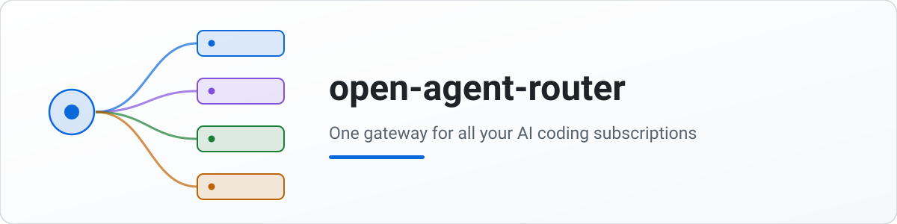
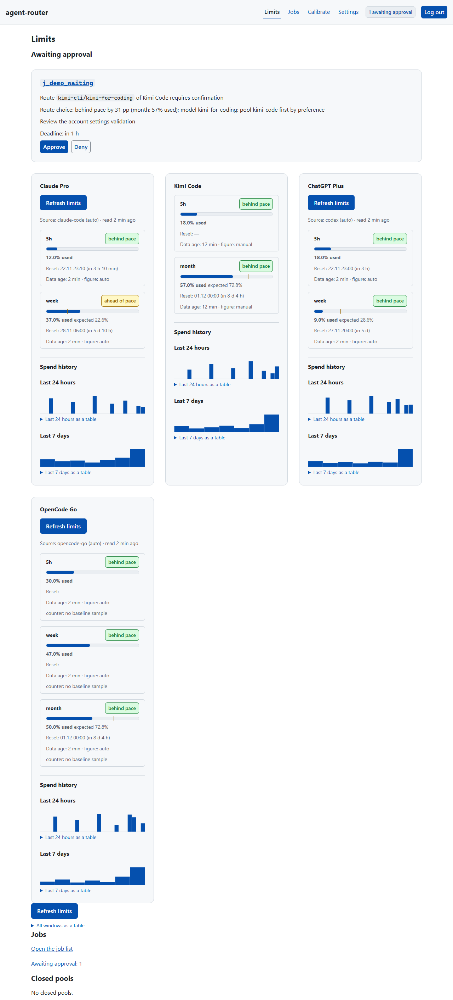
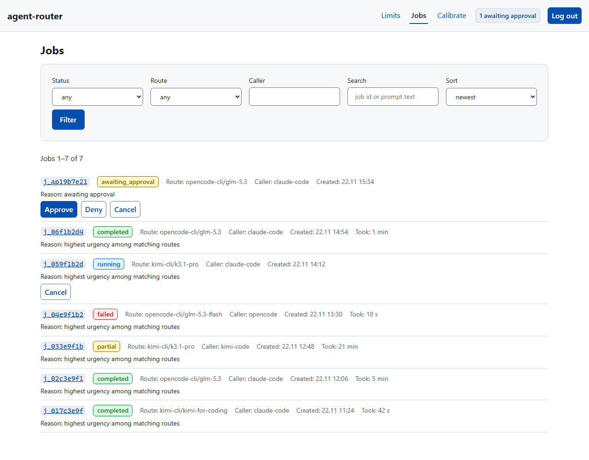
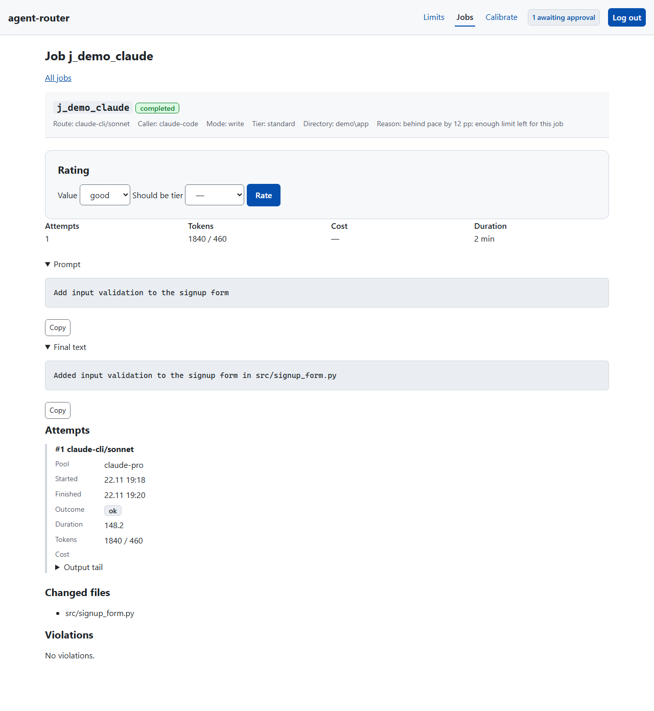

<picture>
  <source media="(prefers-color-scheme: dark)" srcset="https://raw.githubusercontent.com/kdenischenko/open-agent-router/main/docs/assets/banner-dark.svg">
  
</picture>

**English** | [Русский](https://github.com/kdenischenko/open-agent-router/blob/main/README_RU.md)

# open-agent-router

**Hand coding-agent jobs to the AI subscriptions you already pay for — Claude Code, Kimi Code,
OpenCode, Cline — and let a local gateway pick the one with the most limit left.**

[](https://pypi.org/project/open-agent-router/)
[](https://github.com/kdenischenko/open-agent-router/actions/workflows/ci.yml)
[](https://github.com/kdenischenko/open-agent-router/blob/main/LICENSE)
[](https://www.python.org)
[-blue.svg)](https://github.com/kdenischenko/open-agent-router#platforms)
[](https://github.com/kdenischenko/open-agent-router/blob/main/ROADMAP.md)

This is an early alpha (v0.3.0); interfaces and configuration may change.

## Why

You pay for several AI coding subscriptions, but each one has its own limits and pace.
You do not want a job to fail mid-run because a limit ran out, and you do not want to
spend a strong model on a task a cheap one handles fine. open-agent-router is a local
gateway that keeps your subscriptions busy without surprises:

- **Subscriptions do not sit idle.** The gateway tracks usage in every limit window and
  prefers the pool that is furthest behind its pace for the time left in the window. When one
  window is far behind its pace, its pool takes every job it can serve until it catches up.
  This is intended — the under-used subscription is spent first — and `priority` and `weight`
  in the config change the order.
- **Limits do not surprise you.** A pool that reports a limit is blocked until its reset;
  on a usage limit and on an executor error the job moves to another route. A writing
  attempt that already changed files ends `partial` and is not retried.
- **Jobs go where they are cheap enough.** Each job gets a tier — `cheap`, `standard` or
  `strong` — and the gateway picks a route for that tier by priority and by how far each
  subscription is behind its pace. An optional classifier — a local model or a cloud one —
  can assign the tier for you.

It is for you if you have two or more subscriptions to agentic coding CLIs (such as Claude Code,
Kimi Code, OpenCode or Cline) and an orchestrator agent that delegates jobs to others.



## How is this different from LiteLLM, OpenRouter or switching by hand?

- **LiteLLM, OpenRouter and other API gateways** route single model requests using API keys,
  with usage billed per token. open-agent-router hands whole jobs — a prompt, a directory and
  a read or write mode — to the subscriptions you already pay for through their official CLIs,
  and never sees provider keys for those jobs: each CLI uses its own sign-in. Optional usage
  sources and remote classifiers read separately configured keys.
- **Switching by hand** means checking several usage pages and guessing which limit resets
  first. The gateway keeps track of every limit window and its pace, moves a job to another
  route when a limit is hit, and keeps strong models for the jobs that need them.
- **An agent's own model picker** stays inside one subscription. The gateway spreads jobs
  across subscriptions from different providers, and an orchestrator agent can use it through
  the CLI or the MCP server.

## Quick start

You need Python 3.12, [uv](https://docs.astral.sh/uv/), git, and at least one harness CLI
(Kimi Code, OpenCode, Cline or Claude Code), installed and signed in.

```bash
uv tool install open-agent-router
agent-router init --allowed-root <directory>
agent-router serve
```

To run the latest `main` instead, install with `uv tool install git+https://github.com/kdenischenko/open-agent-router`. If
`agent-router` is not found after the install, run `uv tool update-shell` and open a new
terminal. `serve` keeps running in its terminal; stop it with Ctrl+C.

With the gateway running, `agent-router advice --tier standard` shows which routes can take a
job. The `opencode-go` limits in the template are placeholders; replace them with your plan
limits.

The `open-agent-router` package installs the `agent-router` command. `init` creates the
gateway home directory with `config.toml` and two tokens, adds `<directory>` to
`tasks.allowed_roots` (repeat `init --allowed-root` to allow more directories, also on an
existing config, then restart a running `serve`) and prints the next steps. Routes are enabled
for the harnesses `init` finds, including `claude-cli/sonnet`, except Cline: set
`enabled = true` on the `cline/glm-5.3` route in `config.toml` to let jobs use it. Jobs run before
you calibrate the pools; record your real usage later with `agent-router calibrate`. Ready-made configs for typical setups are
in [`docs/examples/`](https://github.com/kdenischenko/open-agent-router/tree/main/docs/examples). Then submit a job from another terminal:

```bash
agent-router run --no-wait --cwd <directory> --mode read "Describe the structure of this repository"
agent-router approve <job-id>
agent-router wait <job-id>
```

`wait` exits 4 while the job is still running; run it again, or use `--timeout` to wait longer.
A job that needs approval returns at once with
`job awaits approval: agent-router approve <id> before <time>, then agent-router wait <id>`.



Every route in the `init` template has `confirm = true`, so a job waits until you approve it
with `approve` or in the dashboard. Set `confirm = false` on a route to let its jobs start
right away. Without a decision the approval expires after `tasks.approval_timeout_s`
(default 600 s): the job ends as `declined` with error `approval_expired` and does not move
to another route.

A job is stopped when it exceeds `tasks.default_timeout_s` (default 14400 s, a hard cap), or
when the harness prints nothing to stdout or stderr for `tasks.idle_timeout_s` (default 600 s;
`0` disables the check). `--timeout` on `run`, or `route.timeout_s`, replaces the hard cap, but
the idle limit still applies. Claude Code emits JSON events while it runs, so the idle limit
applies to its jobs too.

Kimi Code prints one JSON line per finished message, so it is silent while the model writes a
long answer or a subagent works. For kimi jobs the CPU time of the harness process tree and the
files changed in the working directory count as activity too, and a job that is stopped as idle
says which sign of life was seen last. The hard cap applies either way.

The full guide — harness sign-in, limit calibration, autostart on Windows and Linux, the web dashboard
and the delegation skills for orchestrators — is in [docs/INSTALL.md](https://github.com/kdenischenko/open-agent-router/blob/main/docs/INSTALL.md).

## Use from your agent

An orchestrator agent can work through the gateway in two ways.

The first is the MCP server. Register it with your orchestrator, for example with
`claude mcp add agent-router -- agent-router mcp`: it exposes job operations as MCP
tools, and it needs the running gateway. Setup for every supported harness is in
[docs/MCP.md](https://github.com/kdenischenko/open-agent-router/blob/main/docs/MCP.md).

The second way is a delegation skill: ready-made delegation instructions for
orchestrators live in [`integrations/`](https://github.com/kdenischenko/open-agent-router/tree/main/integrations): clone or download the
repository and copy the `agent-router-delegate` folder of your harness into its skills directory.

## How it works

<picture>
  <source media="(prefers-color-scheme: dark)" srcset="https://raw.githubusercontent.com/kdenischenko/open-agent-router/main/docs/assets/architecture-dark.svg">
  
</picture>

You submit a job: a prompt, a directory, a mode and optional hints. The gateway estimates
the tier, checks the remaining limits and pace of every pool, picks a route, queues the
job and — for routes with `confirm = true` — waits until you approve it. It then runs the
coding agent CLI (the *harness*: `claude`, `kimi`, `opencode` or `cline`) as a child process
in the job directory, records the spend and returns the result. See
[docs/DESIGN.md](https://github.com/kdenischenko/open-agent-router/blob/main/docs/DESIGN.md) for the full architecture.

### Where usage figures come from

The route choice is only as good as the usage it knows. Every window shows where its figure
came from (`figure:` in `agent-router status`, the pool card on the dashboard):

| Source | Pools | How it arrives |
|---|---|---|
| Manual calibration | any | `agent-router calibrate` or the dashboard's Calibrate page |
| Claude Code status line | Claude | the status line script posts rate limits to the gateway |
| OpenCode Go usage API | OpenCode Go | read every `[usage].interval` in `auto` mode, or now with `agent-router usage refresh` |
| Claude Code `/usage` | Claude | the signed-in Claude Code CLI, read like the OpenCode Go usage API |
| `opencode stats` counter | `usd` pools | cumulative cost sampled from OpenCode |
| Harness journal | `usd` pools | cost each job reports or is estimated at, added on top of the last figure |

A usage source that fails or goes stale is shown as such in `status`, `doctor` and the
dashboard. Setup is in [docs/INSTALL.md](https://github.com/kdenischenko/open-agent-router/blob/main/docs/INSTALL.md).

## Tier classifier

A job submitted without `--tier` can get its tier from a classifier model. It can be local —
a decision or chat model in [Ollama](https://ollama.com), or any OpenAI-compatible server
such as LM Studio — or a cloud provider over HTTPS with a key from an environment variable.
Several models can vote side by side: in `shadow` mode they only record votes, and
`agent-router classifier report` compares them with the tiers you confirm before you let one
of them decide. Configuration examples, what the classifier receives and measured results are
in [docs/CLASSIFIER.md](https://github.com/kdenischenko/open-agent-router/blob/main/docs/CLASSIFIER.md).

## Dashboard

<picture>
  <source media="(prefers-color-scheme: dark)" srcset="https://raw.githubusercontent.com/kdenischenko/open-agent-router/main/docs/assets/dashboard-dark.png">
  
</picture>

The gateway also serves a dashboard at `http://127.0.0.1:<port>/` (the port is
`server.port`, default 8787). Log in with the admin token: paste the contents of the
`admin.token` file whose path `init` prints.

- **Limits** — jobs waiting for your approval come first, with Approve and Deny. Below them
  is one card per pool: usage, expected pace, reset countdown, data age and figure source for
  each window, including stale and blocked states, with a **Refresh limits** button for pools
  whose usable usage source is not in `manual` mode. Each card also charts journal spend over
  the last 24 hours and seven days, in USD or tokens, with the same numbers in accessible
  tables. The full limits table stays under a disclosure, followed by the routes each tier
  would take right now.
- **Jobs** — filter by status, route and caller, search by job id or prompt text, sort by
  creation time or duration, 50 jobs per page. The filters live in the address, so a filtered
  view can be bookmarked.
- **New job** — a form linked from the Jobs page: working directory, `read`/`write` mode, an optional
  tier (empty lets the gateway decide), the prompt and an optional timeout. It works without JavaScript,
  shows validation errors beside the fields while keeping your values, and on success redirects to the
  new job's page; a route with `confirm = true` still waits for approval before the job runs.
- **Job page** — refreshes itself while the job runs; shows attempt, token, cost and duration
  totals, a per-attempt timeline, the error, and the prompt, final text and per-attempt output
  in expandable blocks with copy buttons; lets you rate a finished job.
- **Calibrate** — record what your subscription page shows. Errors are shown per field and,
  with scripts on, the form previews the pace and the local reset time; after saving, the
  updated pool card is highlighted.
- **Settings** — a read-only view of pools and their windows, routes (including disabled ones),
  caller mappings, and configuration-related doctor findings with hints. Environment variable
  names are shown, but never their values or any tokens.

<table>
  <tr>
    <td width="50%">
      <picture>
        <source media="(prefers-color-scheme: dark)" srcset="https://raw.githubusercontent.com/kdenischenko/open-agent-router/main/docs/assets/jobs-dark.png">
        
      </picture>
    </td>
    <td width="50%">
      <picture>
        <source media="(prefers-color-scheme: dark)" srcset="https://raw.githubusercontent.com/kdenischenko/open-agent-router/main/docs/assets/job-dark.png">
        
      </picture>
    </td>
  </tr>
</table>

## Harnesses

A *harness* is the coding agent CLI that does the work. The gateway runs each one with the
sign-in you already made in it, so harness jobs need no provider keys. Optional usage sources
and remote classifiers read their own configured keys.

| Harness | CLI command | Spend source | Status |
|---|---|---|---|
| Kimi Code | `kimi` | journal | tested live on Windows |
| OpenCode | `opencode` | counter (`opencode stats`) | tested live on Windows |
| Cline | `cline` or `cline-cli` | journal | tested live on Windows |
| Claude Code | `claude` | journal | tested live on Windows |

## Platforms

Windows is supported and tested in CI and live. Linux and macOS are experimental:
the test suite runs on them in CI, but the gateway has not been run live there,
and autostart is documented for Windows and for Linux with `systemd --user`. Help wanted — see
[ROADMAP](https://github.com/kdenischenko/open-agent-router/blob/main/ROADMAP.md).

## Commands

All commands are `agent-router <command>`. Run `agent-router <command> --help` for every
option.

| Command | What it does |
|---|---|
| `init` | Create the gateway home, `config.toml`, tokens; `--allowed-root DIR` allows job dirs |
| `serve` | Run the gateway on `127.0.0.1` (`--port` overrides `server.port`) |
| `mcp` | Run an MCP server over stdio for orchestrator agents |
| `status` | Show pool usage, expected pace and window resets in local time |
| `advice` | Show matching routes for a tier (and `--mode read` or `write`) and why the others are excluded; repeatable `--exclude-pool POOL` omits pools, `--review-of JOB_ID` shows the choice for a review of that job |
| `calibrate POOL WINDOW PERCENT` | Record the usage your subscription shows; `--resets-at` or `--resets-in 10d` sets the reset of a fixed window, a rolling window takes none (admin token) |
| `usage refresh [POOL]` | Read the usage sources now and record what they report; without a pool every pool with a source outside `manual` mode is read, and a pool read within the last 60 s is skipped (admin token) |
| `unblock POOL` | Remove a pool block set after a limit hit (admin token) |
| `run [TEXT]` | Submit a job and wait up to 100 s; `--no-wait` prints the job id, `-` reads the prompt from stdin, repeatable `--exclude-pool POOL` keeps the job off those pools, `--review-of JOB` submits a review kept off the model and pool that wrote the code |
| `wait JOB_ID` | Wait for a job and print its result; retries for up to 10 s while the gateway restarts |
| `result JOB_ID` | Print the status and result of a job without waiting |
| `rate JOB_ID good\|bad\|partial` | Rate a finished job; the last rating wins, a `--note` is stored as hash and length only |
| `jobs` | List jobs with status, route, tier and creation time, optionally by `--status` |
| `cancel JOB_ID` | Cancel a queued or running job |
| `approve JOB_ID` / `deny JOB_ID` | Approve or deny a job that awaits confirmation (admin token) |
| `doctor` | Check config, store, harnesses and gateway; warns when a route's `counter` spend is invisible: the pool counter cannot see its harness, or the pool has no counter; `--live` runs one read job per harness on routes without `confirm` |
| `export --since DATE` | Export jobs, attempts, ratings, classifier votes and usage as JSON Lines or CSV; texts are replaced by hash and length, CSV cells that a spreadsheet would read as a formula get a leading `'` |
| `purge` | Delete terminal jobs older than `storage.retention_days`, with their prompts, results and attempt logs; usage/spend records are kept; `--dry-run` only reports the count |
| `backup [PATH]` | Copy the gateway database consistently while it is being written; without a path writes `<home>/backups/agent-router-<UTC timestamp>.sqlite`, `--keep N` keeps the newest N timestamp-named backups in the target directory |
| `classifier report` | Show classifier votes, errors and accuracy against ratings; `--json` adds the tier matrix and latency |
| `classifier eval --models ID,...` | Replay past prompts through offline classifier models |

Job history is kept forever by default. To bound it, set `retention_days = 30` in `[storage]`,
then run `agent-router purge`. Age is measured from the job's finish time. Queued, running and
awaiting-approval jobs are never purged, and `serve` does not purge automatically. Purge also
removes leftover job directories from earlier failed removals or crashes. Check the count first
with `agent-router purge --dry-run`.

`doctor --statusline-snippet` prints the settings for the Claude Code status line, which reports
Claude usage to the gateway; see [docs/INSTALL.md](https://github.com/kdenischenko/open-agent-router/blob/main/docs/INSTALL.md).

A route without an explicit `spend` inherits the usage source of its harness. When that source is
`counter` and the counter of the route's pool cannot see the route's harness, the pool's `usd`
window never counts the route's spending; `doctor` warns about it and suggests `spend = "journal"`,
which records every job in the journal instead. A route that inherits `counter` on a pool with no
counter is invisible in the same way, and `doctor` warns about it too.

## Exit codes

Commands that call the gateway exit `5` when the gateway is unavailable or rejects the
token, `6` when the request is denied with HTTP 4xx (including a full queue), and `1` on
other errors. For `run`, `wait` and `result`, once the job state is known: `0` —
`completed`, `2` — `partial`, `3` — `failed`, `declined` or `cancelled`, `4` — the job is
not finished yet. `run --no-wait` exits `0` after a successful submit. Local errors
(configuration, store, reading the prompt, a malformed `--resets-at`) exit `1`; `doctor --live`
exits `1` unless every probe completes.

Common failures and their fixes are in [docs/TROUBLESHOOTING.md](https://github.com/kdenischenko/open-agent-router/blob/main/docs/TROUBLESHOOTING.md).

## Environment variables

- `AGENT_ROUTER_HOME` — directory with `config.toml`, tokens and stores; defaults to the
  per-user `agent-router` configuration directory.
- `AGENT_ROUTER_URL` — gateway address for client commands and the Claude Code status line;
  defaults to `http://127.0.0.1:<server.port>` and must use `http` or `https`. Client commands
  report unsupported schemes or URL parsing errors as configuration errors (exit code `1`);
  the status line skips forwarding for these URLs and continues to render the limits.

## Adding a subscription or harness

1. **Pool.** Add a `[[pools]]` section with `[[pools.windows]]` for your plan:
   `unit = "percent"` for subscriptions that show a percentage, or `unit = "usd"` with
   `limit_usd` for subscriptions billed in dollars. Optional: `priority`, `weight` (a
   nudge in percentage points of the pace score, `100 * lag / time left`) and `price_file` —
   a TOML table
   `"<model>" = [input, output]` (USD per 1M tokens) used when the harness does not
   report a cost.
2. **Harness.** For a new CLI, write an adapter module like
   `src/agent_router/adapters/opencode.py` exposing `HARNESS = HarnessSpec(...)` (name,
   adapter, executable names, spend source `counter`/`journal`), register an entry point
   in the `agent_router.harnesses` group in `pyproject.toml`, then `uv sync`. Adapter
   tests use redacted output samples in `tests/fixtures/` and never run the real CLI. If
   the executable is not in PATH, set `[backends.<name>] executable`.
3. **Routes.** Add `[[routes]]` with `pool`, `backend`, `model`, `tiers`, `quality`,
   `modes`; start a new route with `enabled = false`.
4. **Models.** To share one model across pools, give its routes a common `model_key` and
   order the pools in `[models."<model_key>"] prefer = [...]`.
5. **Verify.** `agent-router doctor` shows the harness, its version and enabled routes;
   `agent-router doctor --live` runs one short job per harness (needs a non-empty
   `allowed_roots`); `agent-router status` shows pool usage.

## Security

agent-router is a local tool for a single user and **not a sandbox**: in `--mode write`
the harness starts with auto-approved tools and can change any file your user can touch.
The threat model and how to report a vulnerability are in
[SECURITY.md](https://github.com/kdenischenko/open-agent-router/blob/main/SECURITY.md).

A `read_mode_files_changed` violation on a read-mode job means the working tree changed
while the job ran. If someone else wrote to the same repository in parallel, the
violation is attributed to the job even though the executor changed nothing.

## Subscriptions

Use only official ways to access the providers and follow their terms. You are
responsible for complying with them. The project is not affiliated with the providers
and does not bypass their restrictions.

## Contributing and roadmap

Contributions are welcome: open an issue before a large change, follow
[CONTRIBUTING.md](https://github.com/kdenischenko/open-agent-router/blob/main/CONTRIBUTING.md), and keep the gates green
(`uv run ruff check`, `uv run ruff format --check`, `uv run pytest -q`). Plans — Linux
and macOS support and an OpenAI-compatible proxy — are in
[ROADMAP.md](https://github.com/kdenischenko/open-agent-router/blob/main/ROADMAP.md).

## License

[MIT](https://github.com/kdenischenko/open-agent-router/blob/main/LICENSE).
