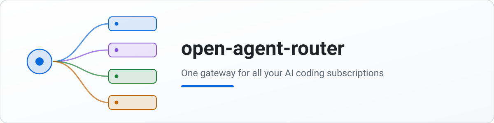
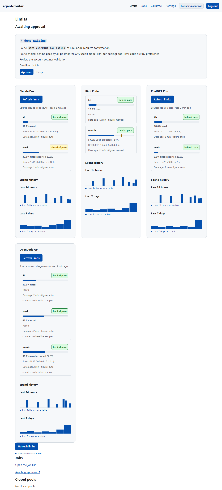
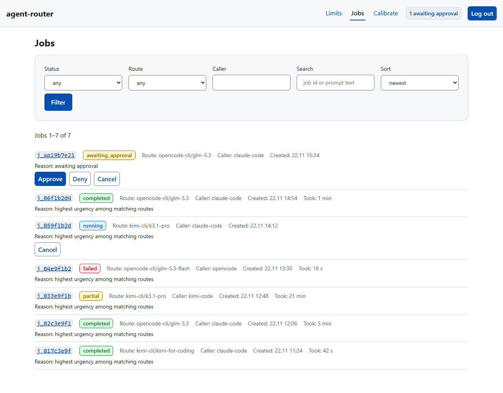
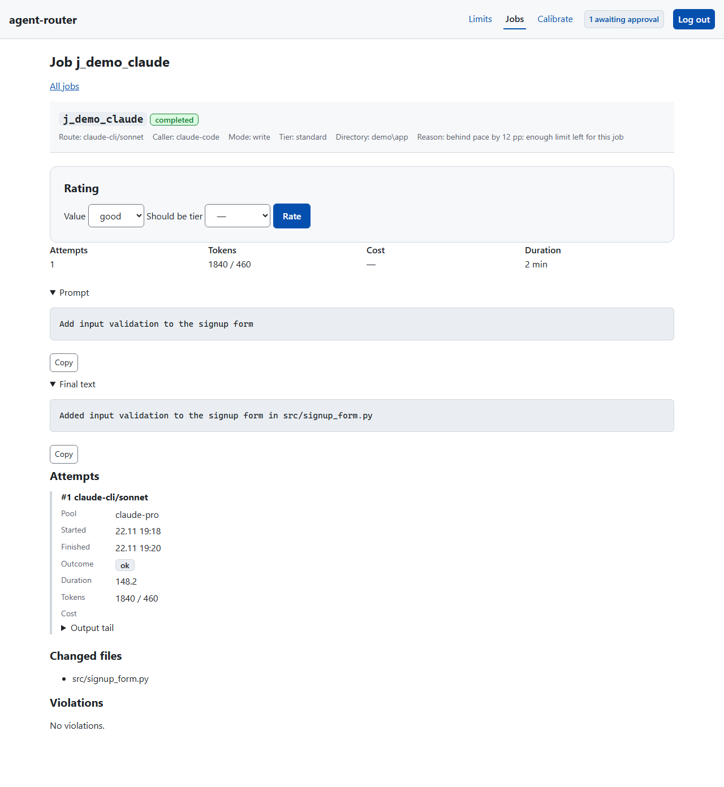

<picture>
  <source media="(prefers-color-scheme: dark)" srcset="https://raw.githubusercontent.com/kdenischenko/open-agent-router/main/docs/assets/banner-dark.svg">
  
</picture>

[English](https://github.com/kdenischenko/open-agent-router/blob/main/README.md) | **Русский**

# open-agent-router

**Передавайте задачи coding-агентам по подпискам на ИИ, которые вы уже оплачиваете, —
Claude Code, Kimi Code, OpenCode, Codex, Cline, — а локальный шлюз выберет подписку с наибольшим
остатком лимита.**

[](https://pypi.org/project/open-agent-router/)
[](https://github.com/kdenischenko/open-agent-router/actions/workflows/ci.yml)
[](https://github.com/kdenischenko/open-agent-router/blob/main/LICENSE)
[](https://www.python.org)
[-blue.svg)](https://github.com/kdenischenko/open-agent-router#platforms)
[](https://github.com/kdenischenko/open-agent-router/blob/main/ROADMAP.md)

Это ранняя альфа-версия (v0.4.0); интерфейсы и конфигурация могут меняться.

## Зачем

Вы платите за несколько подписок на coding-агентов, но у каждой свои лимиты и темп. Вы не
хотите, чтобы задача прервалась посреди выполнения из-за исчерпания лимита, и не хотите
тратить сильную модель на задачу, с которой справится дешёвая. open-agent-router — локальный
шлюз, который использует ваши подписки без неприятных сюрпризов:

- **Подписки не простаивают.** Шлюз отслеживает расход в каждом окне лимита и предпочитает
  пул, который сильнее всего отстаёт от темпа для оставшегося времени окна. Если одно окно
  сильно отстаёт от темпа, его пул забирает все задачи, которые может выполнить, пока не
  догонит. Так задумано — сначала расходуется недоиспользованная подписка; порядок меняют
  параметры `priority` и `weight` в конфигурации.
- **Лимиты не застают вас врасплох.** Пул, сообщивший о лимите, блокируется до его сброса;
  при исчерпании лимита и ошибке исполнителя задача переходит на другой маршрут. Попытка с
  записью, уже изменившая файлы, завершается со статусом `partial` и не повторяется.
- **Задачи выполняются там, где это достаточно дёшево.** Каждой задаче назначается уровень —
  `cheap`, `standard` или `strong`, — и шлюз выбирает маршрут для этого уровня по приоритету
  и отставанию каждой подписки от темпа. Дополнительный классификатор — локальная или
  облачная модель — может назначать уровень за вас.

Проект вам подойдёт, если у вас есть две или более подписки на агентные CLI для
программирования (например, Claude Code, Kimi Code, OpenCode, Codex или Cline) и агент-оркестратор,
который делегирует задачи другим агентам.


## Чем это отличается от LiteLLM, OpenRouter и переключения вручную?

- **LiteLLM, OpenRouter и другие API-шлюзы** направляют отдельные запросы к модели по
  API-ключам, а расход оплачивается за токены. open-agent-router передаёт целые задачи —
  промпт, каталог и режим чтения или записи — по уже оплаченным подпискам через их официальные
  CLI и не видит ключи провайдеров для этих задач: каждый CLI использует собственный вход в
  аккаунт. Дополнительные источники расхода и удалённые классификаторы используют отдельно
  настроенные ключи.
- **Переключение вручную** означает проверку нескольких страниц расхода и догадки о том,
  какой лимит сбросится первым. Шлюз отслеживает каждое окно лимита и его темп, переводит
  задачу на другой маршрут при достижении лимита и резервирует сильные модели для задач,
  которым они нужны.
- **Собственный выбор модели агентом** ограничен одной подпиской. Шлюз распределяет задачи
  между подписками разных провайдеров, а агент-оркестратор может использовать его через CLI
  или MCP-сервер.

## Быстрый старт

Вам нужны Python 3.12, [uv](https://docs.astral.sh/uv/), git и хотя бы один установленный
harness — CLI агента, который выполняет работу, — например Kimi Code, OpenCode, Codex, Cline или
Claude Code, с выполненным входом в аккаунт.

```bash
uv tool install open-agent-router
agent-router init --allowed-root <directory>
agent-router serve
```

Чтобы вместо этого использовать последнюю версию `main`, установите её командой
`uv tool install git+https://github.com/kdenischenko/open-agent-router`. Если после установки
команда `agent-router` не найдена, выполните `uv tool update-shell` и откройте новый терминал.
`serve` продолжает работать в своём терминале; остановите его сочетанием Ctrl+C.

При запущенном шлюзе `agent-router advice --tier standard` показывает, какие маршруты могут
принять задачу. Лимиты `opencode-go` в шаблоне — заполнители; замените их лимитами своего
тарифа.

Пакет `open-agent-router` устанавливает команду `agent-router`. `init` создаёт домашний
каталог шлюза с `config.toml` и двумя токенами, добавляет `<directory>` в
`tasks.allowed_roots` (повторите `init --allowed-root`, чтобы разрешить другие каталоги, в том
числе в существующей конфигурации, затем перезапустите работающий `serve`) и выводит следующие
шаги. Маршруты включаются для всех harness, которые найдёт `init`, включая
`claude-cli/sonnet`, кроме Cline и Codex: установите `enabled = true` на `cline/glm-5.3` или
маршрутах `codex/...` в `config.toml`, чтобы задачи могли их использовать. Задачи запускаются до калибровки пулов;
позже запишите реальный расход с помощью `agent-router calibrate`. Готовые конфигурации для
типовых настроек находятся в
[`docs/examples/`](https://github.com/kdenischenko/open-agent-router/tree/main/docs/examples).
Затем отправьте задачу из другого терминала:

```bash
agent-router run --no-wait --cwd <directory> --mode read "Describe the structure of this repository"
agent-router approve <job-id>
agent-router wait <job-id>
```

`wait` завершается с кодом 4, пока задача ещё выполняется; запустите команду снова или
используйте `--timeout`, чтобы ждать дольше. Задача, требующая одобрения, сразу возвращает
сообщение
`job awaits approval: agent-router approve <id> before <time>, then agent-router wait <id>`.
Пока задача выполняется, `agent-router logs <job-id>` показывает текущий вывод выполняющейся
попытки — маршрут, прошедшее время, последний признак активности и конец журнала попытки, — а
`--follow` продолжает выводить новые строки до завершения задачи. Данные поступают из
`GET /api/v1/jobs/{id}/progress`.



В каждом маршруте шаблона `init` задано `confirm = true`, поэтому задача ждёт, пока вы не
одобрите её командой `approve` или на дашборде. Установите `confirm = false` на маршруте,
чтобы его задачи начинались сразу. Без решения срок одобрения истекает через
`tasks.approval_timeout_s` (по умолчанию 600 с): задача завершается со статусом `declined` и
ошибкой `approval_expired` и не переходит на другой маршрут.

Выполнение задачи останавливается, если она превышает `tasks.default_timeout_s` (по умолчанию
14400 с, жёсткий предел) или если harness ничего не выводит в stdout или stderr в течение
`tasks.idle_timeout_s` (по умолчанию 600 с; `0` отключает проверку). `--timeout` команды `run`
или `route.timeout_s` заменяет жёсткий предел, но ограничение простоя продолжает действовать.
Claude Code выдаёт события JSON во время работы, поэтому ограничение простоя применяется и к
его задачам.

Kimi Code выводит по одной строке JSON на каждое завершённое сообщение, поэтому молчит, пока
модель пишет длинный ответ или работает субагент. Codex также молчит, пока модель рассуждает.
Для задач kimi и codex активностью также считаются процессорное время дерева процессов harness
и изменённые файлы в рабочем каталоге, а остановленная из-за простоя задача сообщает, какой
признак активности был замечен последним. Жёсткий предел действует в любом случае.

Полное руководство — вход в harness, калибровка лимитов, автозапуск в Windows и Linux,
веб-дашборд и навыки делегирования для оркестраторов — находится в
[docs/INSTALL.md](https://github.com/kdenischenko/open-agent-router/blob/main/docs/INSTALL.md).

## Использование из вашего агента

Агент-оркестратор может работать через шлюз двумя способами. Делегировать задачи через него могут
Claude Code, OpenCode, Kimi Code, Cline и Codex.

Первый — MCP-сервер. Зарегистрируйте его в оркестраторе, например командой
`claude mcp add agent-router -- agent-router mcp`: он предоставляет операции с задачами как
инструменты MCP и требует запущенного шлюза. Настройка для каждого поддерживаемого harness
описана в
[docs/MCP.md](https://github.com/kdenischenko/open-agent-router/blob/main/docs/MCP.md).
Те же инструменты также доступны по HTTP по адресу `http://127.0.0.1:<port>/mcp`
(включено по умолчанию; `server.mcp_http = false` отключает endpoint): HTTP-клиенты
используют единственный процесс шлюза, поэтому после переустановки или обновления им
достаточно перезапуска шлюза, а stdio-клиенты требуют перезапуска в каждом harness.

Второй способ — навык делегирования: готовые инструкции по делегированию для оркестраторов
находятся в
[`integrations/`](https://github.com/kdenischenko/open-agent-router/tree/main/integrations):
клонируйте или скачайте репозиторий и скопируйте папку `agent-router-delegate` вашего harness
в его каталог навыков.

## Как это работает

<picture>
  <source media="(prefers-color-scheme: dark)" srcset="https://raw.githubusercontent.com/kdenischenko/open-agent-router/main/docs/assets/architecture-dark.svg">
  
</picture>

Вы отправляете задачу: промпт, каталог, режим и необязательные подсказки. Шлюз оценивает
уровень, проверяет оставшиеся лимиты и темп каждого пула, выбирает маршрут, ставит задачу в
очередь и — для маршрутов с `confirm = true` — ждёт вашего одобрения. Затем он запускает CLI
агента программирования (*harness*: `claude`, `codex`, `kimi`, `opencode` или `cline`) как дочерний
процесс в каталоге задачи, записывает расход и возвращает результат. Полная архитектура
описана в
[docs/DESIGN.md](https://github.com/kdenischenko/open-agent-router/blob/main/docs/DESIGN.md).

### Откуда берутся данные расхода

Выбор маршрута зависит от точности известных данных расхода. Для каждого окна указан источник
значения (`figure:` в `agent-router status`, карточка пула на дашборде):

| Источник | Пулы | Как поступает |
|---|---|---|
| Ручная калибровка | любые | `agent-router calibrate` или страница Calibrate дашборда |
| Строка состояния Claude Code | Claude | скрипт строки состояния отправляет лимиты запросов шлюзу |
| API расхода OpenCode Go | OpenCode Go | читается каждые `[usage].interval` в режиме `auto` или немедленно командой `agent-router usage refresh` |
| Claude Code `/usage` | Claude | авторизованный Claude Code CLI, читается так же, как API расхода OpenCode Go |
| Codex app-server | ChatGPT Plus | пятичасовые и недельные лимиты читаются из авторизованного Codex CLI так же, как из API расхода OpenCode Go |
| Счётчик `opencode stats` | пулы `usd` | совокупная стоимость, периодически считываемая из OpenCode |
| Журнал harness | пулы `usd` | стоимость, сообщённая или оценённая для каждой задачи, добавляется к последнему значению |

Источник расхода, который даёт сбой или устаревает, отмечается соответствующим образом в
`status`, `doctor` и на дашборде. Настройка описана в
[docs/INSTALL.md](https://github.com/kdenischenko/open-agent-router/blob/main/docs/INSTALL.md).

## Классификатор уровней

Задача, отправленная без `--tier`, может получить уровень от модели-классификатора. Это может
быть локальная модель — модель для принятия решений или чат-модель в
[Ollama](https://ollama.com), или любой OpenAI-совместимый сервер, например LM Studio, — либо
облачный провайдер через HTTPS с ключом из переменной окружения. Несколько моделей могут
голосовать параллельно: в режиме `shadow` они только записывают голоса, а
`agent-router classifier report` сравнивает их с уровнями, которые вы подтверждаете, прежде чем
разрешить одной из моделей принимать решение. Примеры конфигурации, данные, получаемые
классификатором, и результаты измерений приведены в
[docs/CLASSIFIER.md](https://github.com/kdenischenko/open-agent-router/blob/main/docs/CLASSIFIER.md).

## Дашборд

<picture>
  <source media="(prefers-color-scheme: dark)" srcset="https://raw.githubusercontent.com/kdenischenko/open-agent-router/main/docs/assets/dashboard-dark.png">
  
</picture>

Шлюз также предоставляет дашборд по адресу `http://127.0.0.1:<port>/` (порт — `server.port`,
по умолчанию 8787). Войдите с токеном администратора: вставьте содержимое файла `admin.token`,
путь к которому выводит `init`.

- **Limits** — ожидающие вашего одобрения задачи показываются первыми, с кнопками Approve и
  Deny. Ниже — по карточке на пул: расход, ожидаемый темп, обратный отсчёт до сброса, возраст
  данных и источник значения для каждого окна, включая состояния устаревания и блокировки, с
  кнопкой **Refresh limits** для пулов, чей пригодный источник расхода не находится в режиме
  `manual`. На каждой карточке также строятся графики расходов по журналу за последние 24 часа
  и семь дней, в USD или токенах, с теми же числами в доступных таблицах. Полная таблица
  лимитов остаётся под раскрывающимся блоком, за которым следуют маршруты, которые каждый
  уровень использовал бы сейчас. Затем идёт сводная таблица **Routes** за последние 30 дней:
  по строке на маршрут, уровень и режим, с исходами задач и попыток, оценками, медианами
  длительности/токенов/стоимости и ранжированием.
- **Jobs** — фильтр по статусу, маршруту и вызывающей стороне, поиск по id задачи или тексту
  промпта, сортировка по времени создания или длительности, 50 задач на страницу. Фильтры
  хранятся в адресе, поэтому отфильтрованное представление можно добавить в закладки.
- **New job** — форма, на которую ведёт ссылка со страницы Jobs: рабочий каталог, режим
  `read`/`write`, необязательный уровень (пустое поле позволяет решить шлюзу), промпт и
  необязательный тайм-аут. Работает без JavaScript, показывает ошибки проверки рядом с полями,
  сохраняя введённые значения, а при успехе перенаправляет на страницу новой задачи; маршрут с
  `confirm = true` по-прежнему ждёт одобрения перед запуском задачи.
- **Job page** — автоматически обновляется во время выполнения задачи; показывает сводные
  показатели попыток, токенов, стоимости и длительности, шкалу времени по попыткам, ошибку, а
  также промпт, итоговый текст и вывод каждой попытки в раскрывающихся блоках с кнопками
  копирования; позволяет оценить завершённую задачу.
- **Calibrate** — записывает показания со страницы вашей подписки. Ошибки показываются для
  каждого поля, а при включённых скриптах форма предварительно показывает темп и локальное
  время сброса; после сохранения выделяется обновлённая карточка пула.
- **Settings** — доступный только для чтения просмотр пулов и их окон, маршрутов (включая
  отключённые), сопоставлений вызывающих сторон и результатов doctor, связанных с
  конфигурацией, с подсказками. Имена переменных окружения показываются, но их значения и любые
  токены — никогда.

<table>
  <tr>
    <td width="50%">
      <picture>
        <source media="(prefers-color-scheme: dark)" srcset="https://raw.githubusercontent.com/kdenischenko/open-agent-router/main/docs/assets/jobs-dark.png">
        
      </picture>
    </td>
    <td width="50%">
      <picture>
        <source media="(prefers-color-scheme: dark)" srcset="https://raw.githubusercontent.com/kdenischenko/open-agent-router/main/docs/assets/job-dark.png">
        
      </picture>
    </td>
  </tr>
</table>

## Harness

*Harness* — это CLI агента программирования, который выполняет работу. Шлюз запускает каждый из
них с уже выполненным в нём входом, поэтому задачам harness не нужны ключи провайдеров.
Дополнительные источники расхода и удалённые классификаторы используют собственные настроенные
ключи.

| Harness | Команда CLI | Источник расхода | Статус |
|---|---|---|---|
| Kimi Code | `kimi` | journal | проверено в реальной работе на Windows |
| OpenCode | `opencode` | counter (`opencode stats`) | проверено в реальной работе на Windows |
| Cline | `cline` или `cline-cli` | journal | проверено в реальной работе на Windows |
| Claude Code | `claude` | journal | проверено в реальной работе на Windows |
| OpenAI Codex | `codex` | journal | проверено в реальной работе на Windows |

## Платформы

Windows поддерживается и тестируется в CI и в реальной работе. Linux и macOS экспериментальны:
на них в CI запускается набор тестов, но шлюз там ещё не запускался в реальной работе, а
автозапуск документирован для Windows и Linux с `systemd --user`. Нужна помощь — см.
[ROADMAP](https://github.com/kdenischenko/open-agent-router/blob/main/ROADMAP.md).

## Команды

Все команды имеют вид `agent-router <command>`. Выполните `agent-router <command> --help`,
чтобы увидеть все параметры.

| Команда | Действие |
|---|---|
| `init` | Создаёт домашний каталог шлюза, `config.toml`, токены; `--allowed-root DIR` разрешает каталоги задач |
| `serve` | Запускает шлюз на `127.0.0.1` (`--port` переопределяет `server.port`) |
| `mcp` | Запускает MCP-сервер через stdio для агентов-оркестраторов |
| `status` | Показывает расход пулов, ожидаемый темп и сброс окон в локальном времени |
| `advice` | Показывает подходящие маршруты для уровня (и `--mode read` или `write`) и причины исключения остальных; повторяемый `--exclude-pool POOL` исключает пулы, `--review-of JOB_ID` показывает выбор для ревью этой задачи, повторяемый `--prefer-route ROUTE` ставит эти маршруты первыми |
| `calibrate POOL WINDOW PERCENT` | Записывает расход, показанный вашей подпиской; `--resets-at` или `--resets-in 10d` задаёт сброс фиксированного окна, для скользящего окна они не задаются (токен администратора) |
| `usage refresh [POOL]` | Немедленно читает источники расхода и записывает их данные; без пула читаются все пулы с источником вне режима `manual`, а пул, прочитанный за последние 60 с, пропускается (токен администратора) |
| `unblock POOL` | Снимает блокировку пула, установленную после достижения лимита (токен администратора) |
| `run [TEXT]` | Отправляет задачу и ждёт до 100 с; `--no-wait` выводит id задачи, `-` читает промпт из stdin, повторяемый `--exclude-pool POOL` не направляет задачу в эти пулы, повторяемый `--prefer-route ROUTE` пробует эти маршруты первыми, но при необходимости возвращается к остальным (в отличие от `--route`, который закрепляет маршрут), `--kind KIND` помечает задачу как `code`, `review`, `research` или `other`, `--review-of JOB` отправляет ревью, которое не попадёт на модель и пул, написавшие код, `--request-id ID` возвращает существующую задачу при повторной отправке |
| `wait JOB_ID` | Ждёт задачу и выводит результат; повторяет попытки до 10 с во время перезапуска шлюза |
| `logs JOB_ID` | Выводит текущий вывод выполняющейся попытки (маршрут, прошедшее время, последний признак активности, конец журнала попытки); `--follow` продолжает выводить новые строки до завершения задачи |
| `result JOB_ID` | Выводит статус и результат задачи без ожидания |
| `rate JOB_ID good\|bad\|partial` | Оценивает завершённую задачу; учитывается последняя оценка, `--note` сохраняется только в виде хэша и длины |
| `jobs` | Выводит задачи со статусом, маршрутом, уровнем и временем создания, при необходимости фильтруя по `--status` |
| `cancel JOB_ID` | Отменяет задачу в очереди или выполняющуюся задачу |
| `approve JOB_ID` / `deny JOB_ID` | Одобряет или отклоняет задачу, ожидающую подтверждения (токен администратора) |
| `doctor` | Проверяет конфигурацию, хранилище, harness и шлюз; предупреждает, если расход `counter` маршрута невидим: счётчик пула не видит его harness или у пула нет счётчика; `--live` запускает по одной задаче чтения на harness на маршрутах без `confirm` |
| `export --since DATE` | Экспортирует задачи, попытки, оценки, голоса классификатора и расход в JSON Lines или CSV; тексты заменяются хэшем и длиной, к ячейкам CSV, которые электронная таблица восприняла бы как формулу, добавляется начальный `'` |
| `purge` | Удаляет завершённые задачи и старую историю расхода по `storage.retention_days`, вместе с промптами, результатами и журналами попыток; записи расхода сохраняются; `--dry-run` только сообщает количество |
| `backup [PATH]` | Согласованно копирует базу данных шлюза во время записи; без пути создаёт `<home>/backups/agent-router-<UTC timestamp>.sqlite`, `--keep N` сохраняет N новейших резервных копий с метками времени в имени в целевом каталоге |
| `classifier report` | Показывает голоса классификатора, ошибки и точность относительно оценок; `--json` добавляет матрицу уровней и задержку |
| `classifier eval --models ID,...` | Повторно пропускает прошлые промпты через офлайн-модели классификатора |
| `report routes` | Сводная таблица с одной строкой на маршрут, уровень и режим: исходы задач и попыток, доли оценок, медианы длительности/токенов/стоимости (оценённые значения помечены `~`); строки минимум с 5 задачами ранжируются по доле good, остальные указаны как неранжированные; `--since DATE` ограничивает период, `--json` выводит строки |

История задач по умолчанию хранится бессрочно. Чтобы ограничить её, установите
`retention_days = 30` в `[storage]`, затем выполните `agent-router purge`. Возраст отсчитывается
от времени завершения задачи. Задачи в очереди, выполняющиеся и ожидающие одобрения никогда не
удаляются, а `serve` не выполняет очистку автоматически. Очистка также удаляет оставшиеся
каталоги задач после прежних неудачных удалений или сбоев. Старые наблюдения и выборки
счётчиков удаляются по тому же сроку хранения; для каждого окна пула сохраняются последнее
наблюдение и последнее пригодное время сброса, а выборки хранятся вдвое дольше самого длинного
настроенного окна. Сначала проверьте все количества с помощью `agent-router purge --dry-run`.

`doctor --statusline-snippet` выводит настройки строки состояния Claude Code, которая сообщает
шлюзу о расходе Claude; см.
[docs/INSTALL.md](https://github.com/kdenischenko/open-agent-router/blob/main/docs/INSTALL.md).

Маршрут без явного `spend` наследует источник расхода своего harness. Если этот источник —
`counter`, а счётчик пула маршрута не видит harness маршрута, окно `usd` пула никогда не
учитывает расход маршрута; `doctor` предупреждает об этом и предлагает `spend = "journal"`, при
котором каждая задача вместо этого записывается в журнал. Маршрут, наследующий `counter` в пуле
без счётчика, так же невидим, и `doctor` предупреждает и об этом.

## Коды завершения

Команды, обращающиеся к шлюзу, завершаются с кодом `5`, если шлюз недоступен или отклоняет
токен, с кодом `6`, если запрос отклонён с HTTP 4xx (включая полную очередь), и с кодом `1` при
других ошибках. Для `run`, `wait` и `result`, когда состояние задачи известно: `0` —
`completed`, `2` — `partial`, `3` — `failed`, `declined` или `cancelled`, `4` — задача ещё не
завершена. `run --no-wait` завершается с кодом `0` после успешной отправки. Локальные ошибки
(конфигурация, хранилище, чтение промпта, неправильный `--resets-at`) завершаются с кодом `1`;
`doctor --live` завершается с кодом `1`, если не все проверки завершились успешно.

Распространённые сбои и их устранение описаны в
[docs/TROUBLESHOOTING.md](https://github.com/kdenischenko/open-agent-router/blob/main/docs/TROUBLESHOOTING.md).

## Переменные окружения

- `AGENT_ROUTER_HOME` — каталог с `config.toml`, токенами и хранилищами; по умолчанию
  используется каталог конфигурации `agent-router` текущего пользователя.
- `AGENT_ROUTER_URL` — адрес шлюза для клиентских команд и строки состояния Claude Code; по
  умолчанию `http://127.0.0.1:<server.port>`, должен использовать `http` или `https`.
  Клиентские команды сообщают о неподдерживаемых схемах или ошибках разбора URL как об ошибках
  конфигурации (код завершения `1`); строка состояния пропускает пересылку для таких URL и
  продолжает отображать лимиты.

## Добавление подписки или harness

1. **Пул.** Добавьте секцию `[[pools]]` с `[[pools.windows]]` для вашего тарифа:
   `unit = "percent"` для подписок, показывающих процент, или `unit = "usd"` с `limit_usd` для
   подписок с оплатой в долларах. Необязательно: `priority`, `weight` (корректировка оценки
   темпа в процентных пунктах, `100 * lag / max(1 - expected, 0.02) + weight`) и `price_file` —
   таблица TOML
   `"<model>" = [input, output]` (USD за 1 млн токенов), используемая, когда harness не
   сообщает стоимость.
2. **Harness.** Для нового CLI напишите модуль адаптера, например
   `src/agent_router/adapters/opencode.py`, предоставляющий `HARNESS = HarnessSpec(...)` (имя,
   адаптер, имена исполняемых файлов, источник расхода `counter`/`journal`), зарегистрируйте
   точку входа в группе `agent_router.harnesses` в `pyproject.toml`, затем выполните `uv sync`.
   Тесты адаптера используют очищенные образцы вывода в `tests/fixtures/` и никогда не
   запускают реальный CLI. Если исполняемый файл отсутствует в PATH, задайте
   `[backends.<name>] executable`.
3. **Маршруты.** Добавьте `[[routes]]` с `pool`, `backend`, `model`, `tiers`, `quality`,
   `modes`; начните новый маршрут с `enabled = false`.
4. **Модели.** Чтобы использовать одну модель в нескольких пулах, задайте её маршрутам общий
   `model_key` и упорядочьте пулы в `[models."<model_key>"] prefer = [...]`.
5. **Проверка.** `agent-router doctor` показывает harness, его версию и включённые маршруты;
   `agent-router doctor --live` запускает одну короткую задачу на harness (требуется непустой
   `allowed_roots`); `agent-router status` показывает расход пула.

## Безопасность

agent-router — локальный инструмент для одного пользователя и **не песочница**: в `--mode write`
harness запускается с автоматически одобренными инструментами и может изменить любой файл,
доступный вашему пользователю. Модель угроз и порядок сообщения об уязвимостях описаны в
[SECURITY.md](https://github.com/kdenischenko/open-agent-router/blob/main/SECURITY.md).

Нарушение `read_mode_files_changed` в задаче режима чтения означает, что рабочее дерево
изменилось во время выполнения задачи. Если кто-то другой параллельно писал в тот же
репозиторий, нарушение приписывается задаче, даже если исполнитель ничего не изменил.

## Подписки

Используйте только официальные способы доступа к провайдерам и соблюдайте их условия. Вы
несёте ответственность за их соблюдение. Проект не связан с провайдерами и не обходит их
ограничения.

## Участие в разработке и дорожная карта

Вклад приветствуется: создайте issue перед крупным изменением, следуйте
[CONTRIBUTING.md](https://github.com/kdenischenko/open-agent-router/blob/main/CONTRIBUTING.md)
и следите за успешным прохождением проверок
(`uv run ruff check`, `uv run ruff format --check`, `uv run pytest -q`). Планы — поддержка
Linux и macOS и OpenAI-совместимый прокси — приведены в
[ROADMAP.md](https://github.com/kdenischenko/open-agent-router/blob/main/ROADMAP.md).

## Лицензия

[MIT](https://github.com/kdenischenko/open-agent-router/blob/main/LICENSE).
