# agent-router — design

This document describes how the code works today. It reflects the implementation in
`src/agent_router/`; where behavior is planned but not implemented, it says so explicitly.

## Overview

agent-router is a local gateway that distributes coding jobs between AI subscription harnesses
(Claude Code, Kimi Code, OpenCode, Cline). An orchestrator (typically one of these same harnesses
running the `agent-router-delegate` skill, or a human using the CLI) submits a job: a prompt, a
working directory, a mode, and optional hints. The gateway classifies the job's difficulty,
picks a route by a deterministic policy over the remaining subscription quotas, asks for human
confirmation when the route requires it, runs the harness CLI as a child process, records the
spend, and returns the result. It listens on `127.0.0.1` only and authenticates callers with
bearer tokens. The gateway is not an agent itself: anything that touches tools or files is
delegated to a harness.

<picture>
  <source media="(prefers-color-scheme: dark)" srcset="assets/architecture-dark.svg">
  
</picture>

## Concepts

- **Pool** — one subscription's quota: a set of windows, a unit (`percent` or `usd`), optional
  model weights, a reserve, and levers (`priority`, `weight`). Several routes may spend one pool.
- **Window** — a quota window inside a pool: `duration` (for example `5h`, `7d`, `1mo`), a kind
  (`fixed` — resets at a known or anchored moment, or `rolling`), a role (`pace` — drives
  scheduling; `guard` — only blocks; rolling windows cannot be `pace`), and `block_at`, the used
  fraction at which the pool stops serving.
- **Route** — a `pool` + `backend` + `model` triple with `tiers`, `quality` (1–5), `modes`,
  `confirm`, `enabled`, and optional per-route levers. The route `kind` is `harness`.
- **Tier** — job difficulty: `cheap`, `standard`, or `strong` (in that order).
- **Job** — a unit of work: prompt, working directory, mode, caller, and resulting lifecycle.
- **Harness** (also **executor**) — the agent CLI that runs a job: `claude`, `opencode`,
  `cline` or `kimi`.
- **Attempt** — one execution of a job on one route. A job may have several attempts (fallback).
- **Caller** — who submitted the job; `[callers]` maps a caller name to a pool, and that pool is
  excluded from routing (a caller uses its own subscription directly).
- **Mode** — `read` (the harness must not modify files) or `write` (it may).
- **Confirmation** — routes with `confirm = true` pause the job until a human approves or denies
  it with the admin token.

## Job lifecycle

Statuses: `queued`, `awaiting_approval`, `running`, and terminal `completed`, `partial`,
`failed`, `declined`, `cancelled`. Legal transitions: `queued` → any other; `awaiting_approval`
→ `queued`, `declined` or `cancelled`; `running` → `completed`, `partial`, `failed`, `queued`,
`cancelled`.
All transitions go through the dispatcher; worker threads never change status directly.

Flow per dispatcher tick:

1. Classifier votes and finished attempts are collected; expired pool blocks are lifted.
2. Queued jobs are considered in creation order while slots are free
   (`tasks.max_parallel`, default 3). A job waiting on the classifier is skipped until
   `classifier.wait_s` elapses, then its tier is resolved (see Classifier). A write job waits
   if another job holds the single-writer lock on its repository.
3. The request is re-validated; rejections (for example `cwd_not_allowed`, `queue_full`)
   finish the job as `failed`. The job directory and its repository root are resolved once at
   intake and reused for the writer lock, the before snapshot, the harness launch and the after
   measurement. If either resolves elsewhere later, the job fails with `cwd_changed`; an attempt
   in progress ends with an error and unknown changes. After `tasks.max_attempts` (default 3) it
   fails with `attempts_exhausted`.
4. The policy chooses a route. With no route: `declined` if a confirmation was refused earlier,
   otherwise `failed` with code `no_route` and per-route exclusion reasons.
5. A `confirm` route moves the job to `awaiting_approval` with a deadline
   (`tasks.approval_timeout_s`, default 600 s). Approval pins the route and requeues; denial
   excludes that route, sets `had_refusal`, and requeues; expiry declines the job with
   `approval_expired` and does not move it to another route.
6. Otherwise an attempt starts: the prompt is written to `jobs/<id>/prompt.md`, a git snapshot
   (`HEAD` + working tree) is taken, and the runner is submitted to the thread pool.

Attempts and fallback: an attempt ends with outcome `ok`, `limit`, `error`, `timeout`, or
`cancelled`. On `limit` the pool is blocked (see below) and, unless the attempt changed files or
left a process behind, the pool is added to the job's `excluded_pools` and the job is requeued —
the next attempt goes to another route. On `error` (an executor failure) the same happens by
route: unless the attempt changed files or left a process behind, the route is added to the job's
`excluded_routes` and the job is requeued, so the next attempt goes to another route. A job pinned
to a route (`request.route`) is not moved: its error ends as `failed`, as does a route whose
executable is missing. A write attempt that changed files and then failed ends as `partial` (no
automatic retry); a clean failure that is not moved to another route (a timeout, a pinned
route, no route left) ends as `failed`.

Route health: a route with `ROUTE_ERROR_STREAK` (2) error attempts in a row — errors finished
after the route's last `ok` attempt, a later `ok` resets the streak — is marked unavailable for
`ROUTE_ERROR_COOLDOWN_S` (1800 s). The policy excludes such a route and `advice` shows
`harness unavailable: N errors in a row, retry after <local time>`; after the cooldown the route
is available again. A route the caller pinned still runs, and a job already approved for a route
keeps it.

Limit detection is adapter-side (error patterns and reset times parsed from CLI output). The
dispatcher blocks the pool until the reported reset time, or by exponential backoff
(`tasks.limit_backoff_s` doubling per consecutive limit hit, capped at
`tasks.limit_backoff_max_s`). Blocks expire on tick or via manual `unblock` (admin).

Recovery after restart: queued jobs are simply picked up again. Stored `running` jobs whose last
attempt finished are finalized from the stored result; otherwise the dispatcher reaps the recorded
harness process if its PID, image name and start time still match, re-measures the working tree,
and finishes the job as `partial` or `failed` with `gateway_restarted`. A Windows job object's
handle is deliberately not persisted: `KILL_ON_JOB_CLOSE` has already stopped its tree when the
old gateway exited. Without a job object, recovery still checks only the harness PID; a descendant
left behind by an already-exited harness is not discoverable and can escape both reaping and the
`orphan_process` violation.

Violations recorded on the job: `head_moved` (git HEAD changed during the attempt),
`read_mode_files_changed`, `changes_unknown` (post-attempt tree measurement failed),
`orphan_process` (the harness or a member of its Windows job survived its stop, or the recorded
harness could not be reaped).

## Route choice

The policy is a pure function of the request and the quota snapshot. Exclusion filters, in order
(first match wins, with the reason logged): route `enabled = false`; harness executable
unavailable; `tier` not in `route.tiers`; `mode` not in `route.modes`; route or pool excluded for
this job; caller's own pool; pool blocked until a known time; a window exhausted past its
`block_at`; and the reserve rule — if the pool's remaining headroom is at or below `reserve`,
jobs below `reserve_tier` are excluded. Explicitly requested routes skip the tier, caller, and
reserve filters and ignore `priority`/`weight`.

Survivors are ordered by a key built from: `prefer` rank (when several routes share a
`model_key`, `[models."<key>"] prefer = [pools...]` orders their pools), `priority` (lower
first), pacing score, `quality` (higher first), and route id. The score is
`lag * 100 + weight`, where `weight` nudges the score in percentage points. Levers resolve
route → backend → pool default. Routes with no usage data get score 0 and sort after routes with
data at equal priority.

Pacing compares expected and actual usage per `pace` window: `expected` is the elapsed share of
the current window, `used` is the consumed share, `lag = expected - used`. Positive lag means the
pool is under-consuming and should be preferred; the pool's lag is the minimum across its pace
windows (the window closest to exhaustion dominates). The same function backs the
`advice` API and CLI, so the shown recommendation is exactly what a job with the same tier, mode
and caller would get.

## Usage tracking

The ledger computes each window's state from observations and spend records:

- **Observations** (`pool`, `window`, `fraction` 0..1, `observed_at`, optional `resets_at`,
  `source`) come from manual calibration (`calibrate` command / `POST /api/v1/observations`),
  from the Claude Code status line (a small script posts the `rate_limits` block —
  `five_hour` and `seven_day` percentages with reset times — to
  `/api/v1/signals/claude-statusline`), or from synthetic scheduled resets of fixed windows.
- **Counters**: for pools with `counter = "opencode_stats"` the collector periodically runs
  `opencode stats --json --cost --models --all` and stores cumulative USD samples; growth
  between samples is attributed to the window. A counter declares the harnesses it can see in its
  `sees` set: a route whose spend source is `counter` is invisible to a counter that does not list
  its harness, so `doctor` suggests `spend = "journal"` for it. A route that inherits `counter` on
  a pool with no counter has nothing to read, so `doctor` suggests `spend = "journal"` for it too.
  The baseline is the sample nearest to the observation time, or to the window start after a
  scheduled reset, within the tolerance; after a reset with no such sample the first later sample
  is used and the window is marked as a lower bound. A change in model weights (the pool's `scale_hash`)
  invalidates the base and asks for recalibration.
- **Spend records** are written per attempt: pool, route, tokens in/out, `cost_usd`, and an
  `estimated` flag. For `usd` pools the spend since the window base is added on top of the
  observed fraction.

Cost is exact when the harness reports it (`cost_estimated = false`). Otherwise it is estimated
from the pool's `price_file` — a TOML table `"<model>" = [in, out]` in USD per 1M tokens —
multiplied by the model weight `limit_base_usd / model_limits[model]`, and tagged with the price
file's content version. Rolling-window observations older than the window are treated as "no
data"; exhausted-at-`block_at` windows block the pool. A fixed-window observation without
`resets_at` keeps the latest reset time an earlier observation of that window reported, moved
forward by whole windows; without one it falls back to the window `anchor`.

## Classifier

The classifier predicts the required tier (`cheap` / `standard` / `strong`) from the prompt.
Three kinds exist: `systemone` (POST to `{url}/v1/systemone`, a score + confidence answer taken
from the class probabilities), `ollama` (POST to `{url}/api/chat` with a JSON-schema answer;
confidence recomputed from token logprobs) and `openai` (POST to `{url}/chat/completions` with a
JSON-schema `response_format`; confidence from token logprobs when the server returns them,
otherwise the model's own). A URL is either loopback or `https` with `api_key_env`: the key is
read from that environment variable at every request and sent as a bearer token; a missing key
ends the vote with `no_api_key` without a request. A loopback URL is reached directly, without
the environment proxy; an `https` URL keeps using it. The classifier receives the prompt, cut to
its first 3000 and last 1000 characters when longer than 4000. Examples and measurements are in
[CLASSIFIER.md](CLASSIFIER.md).

Config `[classifier]`: `mode` (`shadow` — votes are recorded but never applied — or `active`),
`primary` (the deciding model id), `min_confidence` (default 0.6, per-model override possible),
`write_floor` (default `standard`: write jobs are never classified below this tier),
`wait_s`, `vram_budget_mb`, and `[[classifier.models]]` entries (`id`, `kind`, `model`, `url`,
`timeout_s`, `api_key_env`, `live`). In active mode a missing or low-confidence vote falls back to `standard`;
an unavailable classifier never stops the gateway. In shadow mode the caller's hint or the
default decides, and agreement is measured from stored votes.

Votes run through a single priority queue (primary model first; a bounded backlog drops
secondary votes under load). `classifier eval` replays past job prompts through selected models
offline: it unloads live local Ollama models from VRAM and marks the votes `offline`; live
voting resumes afterwards. `classifier report` computes, per classifier and split by
live/offline: accuracy against ground truth (manual `should_tier` ratings, then caller tiers of
jobs rated `good`), the tier confusion matrix, the underestimation rate, latency p50/p95, error
rate, and a before/after split around the last `mode` change.

## Runner and harness adapters

The runner starts the harness without a shell: `Popen(argv, cwd, env, stdout/stderr to pipes)`.
The environment is inherited plus `NO_COLOR=1` and `PWD` set to the working directory (opencode
reads it). On Windows the child gets its own process group and no console window. Each attempt
also gets a Job Object with `JOB_OBJECT_LIMIT_KILL_ON_JOB_CLOSE`: the harness is created suspended,
assigned to the job, and only then resumed, closing the launch/assignment race. Descendants join
the same job. Stopping or finishing an attempt terminates the job and queries its process list;
anything left sets `survived` and produces `orphan_process`. Job, process and thread handles are
closed on every exit, and closing the last job handle also stops the tree if the gateway crashes.
Windows 8 and later support nested jobs, but an enclosing job or policy can reject assignment. If
job creation or assignment fails, the harness is resumed and the legacy
`taskkill /PID <pid> /T /F` stop remains in use; in that mode a descendant of a dead harness is not
visible to the survivor check. On POSIX, stopping still uses `SIGTERM` then `SIGKILL` to the process
group. Output is streamed to per-attempt log files, capped at 20 MiB per stream with a truncation
marker.
Timeouts: per-job `timeout_s`, else `route.timeout_s`, else `tasks.default_timeout_s`
(14400 s, a hard cap). A harness that produces no stdout or stderr for `tasks.idle_timeout_s`
(600 s) is stopped as idle; `0` disables the check. An explicit per-job or route `timeout_s`
replaces the hard cap, but the idle limit still applies. Each adapter declares
`reports_progress`: Claude Code prints its JSON only at the end (`False`), so its jobs get only
the hard cap; kimi, opencode and cline stream their output (`True`). After an adapter-recognized
final line a lingering process is killed within `tasks.exit_grace_s` (60 s). Long prompts or shim
(`.cmd`/`.bat`) executables switch the prompt from argv to a prompt file with a "read the task
from the file" instruction; shim arguments are validated against a safe character set.
OpenCode runs with `--standalone` so its session uses a private server in the child process tree;
without it, stopping the `opencode run` client would leave the session running in the background
service.

Adapters (`adapters/`) build argv/stdin and parse output:

- **kimi** — `kimi -p <text> -m <model> --output-format stream-json`; prompt in argv (or a prompt
  file); read mode is enforced by the preamble only; NDJSON events, last assistant message is
  the answer; spend source `journal`.
- **claude** — `claude -p --output-format json --model <m> --permission-mode <mode>`, prompt via
  stdin; read maps to `plan`, write to `acceptEdits`; one JSON object with `result`, `usage`,
  `total_cost_usd`; spend source `journal`.
- **opencode** — `opencode run --format json --archived --standalone --model <m>`, prompt via
  stdin; read maps to `--agent plan`, write to `--auto`; NDJSON `step_finish` events carry tokens
  and cost; spend source `counter`.
- **cline** — `cline --json -P <provider> -m <model> [--plan | --auto-approve true] -- <prompt>`;
  read maps to `--plan`, write to `--auto-approve`; the `run_result` event carries tokens and
  cost; spend source `journal`.

Every adapter prepends a preamble to the prompt: work only in the given directory, no
`git commit` / `git push` / history rewriting, no long-running background processes, end with a
concise report; read mode adds "do not create, modify, or delete any files". Each adapter module
exposes `HARNESS = HarnessSpec(...)` and registers via the `agent_router.harnesses` entry-point
group; counters use `agent_router.counters`.

## Storage and API

One SQLite database (`agent-router.sqlite` in the gateway home; WAL, schema versioning via
`user_version`, pluggable through the `agent_router.storage` entry point). Tables: `observations`,
`counter_samples`, `jobs` (JSON blob per job, including the request with its prompt; `prompt_sha256`
and `prompt_chars` let exports omit the text), `attempts` (one row per attempt with result, git
snapshots, log tail, spend source, decision snapshot), `pool_blocks`, `spend`, `ratings` (note kept
as hash + length only), `classifier_votes`, and `settings` (atomic flags, panel epoch, export salt).

Events: an in-process `EventBus` with named subscribers, each on its own daemon thread with a
bounded queue (overflow drops, never blocks). Event payloads pass a JSON round-trip plus a key
blacklist (no prompts, paths, tokens). Sinks are file/plugin based — a built-in rotating JSONL
sink; events are not stored in SQLite.

HTTP API under `/api/v1` (token in `Authorization: Bearer`; the admin token satisfies client
routes; only `127.0.0.1`/`localhost` Host headers are accepted):

- Client: `GET /snapshot`, `POST /signals/claude-statusline`, `GET /advice`, `GET /events/stats`,
  job operations — `POST /jobs`, `GET /jobs`, `GET /jobs/{id}`, `GET /jobs/{id}/wait`
  (long-poll, capped), `POST /jobs/{id}/cancel`, `POST /jobs/{id}/rating`.
- Admin: `POST /observations` (calibration), `POST /jobs/{id}/approve`, `POST /jobs/{id}/deny`,
  `POST /pools/{id}/unblock`.
- `GET /healthz` is unauthenticated.

Request bodies are limited before parsing, since the token is checked only after the body is read:
under `/api/` the limit is room for the longest accepted prompt (`tasks.max_prompt_chars` × 12 bytes,
the worst case of a JSON-escaped character, plus 64 KiB), dashboard forms get 64 KiB. A declared
`Content-Length` over the limit is rejected at once, a streamed body as soon as it passes the limit;
both answer `413` with the code `body_too_large`.

Tokens are files `client.token` / `admin.token` in the gateway home, created by `init` (or the first
`serve`) with owner-only permissions where the OS supports them. The dashboard (`web.py`, Jinja2, no
frontend build) logs in with the admin token and sets a signed `ar_session` cookie (HMAC keyed from
the admin token, revocable via a settings epoch); every POST form carries a per-session CSRF token.
Pages: limits with pacing, advice, jobs with approve/deny/cancel, calibration form; the job
page refreshes itself, shows the error and lets you rate a finished job.

## Module map

| Module | Responsibility |
|---|---|
| `api.py` | FastAPI app: routes, token checks, host guard, lifespan wiring |
| `auth.py` | Token files, dashboard session cookies, CSRF tokens |
| `classifier.py` | systemone/ollama/openai clients, vote queue, tier resolution, offline eval, report |
| `cli.py` | `agent-router` root app and commands not yet split into their own module |
| `cli_common.py` | Helpers shared by the CLI command modules (config loading, gateway client, quoting) |
| `client.py` | Minimal stdlib HTTP client used by the CLI |
| `clock.py` | Clock protocol (system/fake), UTC helpers, local-time formatting |
| `config.py` | TOML schema, validation, defaults, levers, tiers |
| `dispatcher.py` | Job state machine: scheduling, attempts, fallback, blocks, recovery |
| `events.py` | In-process event bus with per-subscriber threads |
| `export.py` | Redacted JSONL/CSV export of jobs, spend, observations |
| `jobs.py` | Job/attempt/rating/vote data model, statuses and transitions |
| `jobstore.py` | SQLite storage for jobs, attempts, ratings, votes, blocks, spend |
| `ledger.py` | Window state from observations, counters, and spend |
| `mcp_server.py` | MCP tools over stdio for orchestrators; gateway client API, no admin actions |
| `pacing.py` | Expected vs used usage, lag, reserve and block computation |
| `periods.py` | Window durations and boundary arithmetic |
| `plugins.py` | Entry-point loading for harnesses, counters, storage, sinks |
| `policy.py` | Deterministic route filters and ordering |
| `prices.py` | Price-file parsing and token-based cost estimation |
| `registry.py` | Harness/counter specs, backend resolution, config validation |
| `runner.py` | Child-process execution, log capture, timeouts, process-tree kill |
| `service.py` | Gateway composition: snapshot cache, waiters, background loops |
| `settings_store.py` | Atomic key-value flags over the `settings` table |
| `sinks.py` | Event sink protocol and the rotating JSONL sink |
| `spend.py` | Spend records and attempt cost estimation |
| `statusline.py` | Claude Code status line script (posts rate limits to the gateway) |
| `store.py` | SQLite storage for observations and counter samples |
| `web.py` | Dashboard pages and fragments |
| `worktree.py` | Git snapshots, changed-file detection, path sanitizing |
| `adapters/base.py` | Adapter protocol, preamble, outcome settling, limit hints |
| `adapters/{kimi,claude,opencode,cline}.py` | Per-harness argv and output parsing |
| `collectors/claude_statusline.py` | Status-line JSON to observations |
| `collectors/opencode_stats.py` | `opencode stats` counter sampler |

## Planned

- **Model-request path**: an OpenAI-compatible proxy and direct API providers. The config keys
  `[upstreams]` and route `kind = "api"` are reserved for it; until it exists the config is
  rejected if they are used.
- **Linux and macOS support**: the process, git, and CLI layers have POSIX branches and the test
  suite runs on Linux and macOS in CI (experimental, allowed to fail); the gateway has been run
  live only on Windows, and autostart exists only there.
